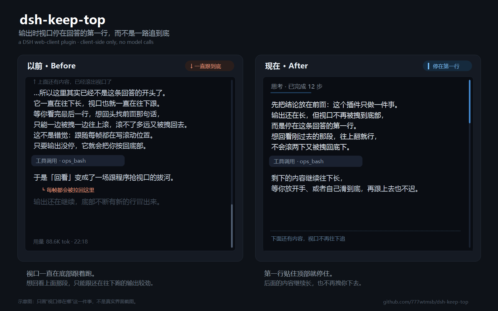

[English](README.md) | **中文**

# dsh-keep-top




一个只做**一件事**的 DeepSeek Harness（DSH）网页客户端小插件：回答流式输出时，视口跟着它走，但只跟到**这轮回答的第一行贴住屏幕顶部**为止，然后就停在那儿。

这样你想往回翻一点、重读刚过去的那段时，就不用跟还在往下拽你的输出较劲。

不调模型、不联网、不读写文件、不加任何 DOM。只有一个客户端文件，约 300 行。

---

## 为什么不用现成的插件？

`dsh-streamfold`（热门的折叠插件）覆盖了很多，但它要自己折叠过程行，就必须把官方展示档强制写成 `transcriptView: verbose`。副作用是每一步思考都变成独立一行，官方的「思考 · 已完成 N 步」一行合并消失——观感变化很大。

`dsh-chat-answer-anchor` 走另一个极端：把整个视口冻住，结果回答完了还得自己手动往下滑。

这个插件走的是窄路：**官方展示档保持 `standard`**（过程行仍是官方的一行合并），只在恰当的时机接管滚动写入。

---

## 它做了什么

一轮开始时，下面这些条件**全部**成立，插件才接管滚动：

1. 这一轮的正文行（`data-chat-flow-kind="assistant-step"`，不是思考步骤、不含工具块）**到达**视口顶部（在 `topGap` 以内）；
2. 它没有已经远远越过顶部——如果在视口上方超过 `farPastPx`（400 px），就不算“正在到达”了；
3. 内容仍在增长（最近 `streamWindowMs` 内文本变过，默认 2000 ms）；
4. 视口在底部附近（64 px 以内），且已经持续至少 250 ms。

按住期间，它每帧重新测量正文行，而不是钉一个像素值——一轮结束时 DSH 会把上面的过程行折叠成一行，钉死的像素会跟着这次重排一起被拖走。

任何用户输入——滚轮、触摸、按下指针、PageUp/PageDown/↑/↓/Home/End——都会立刻交还写权，本轮剩下的时间插件不再插手。

切到别的会话再切回来**不会**把你弹到本轮开头：路由变化会重置状态，重新进入时“内容增长”和“在底部”这两个条件都不成立。

底层思路和 `dsh-streamfold` 一样——接管滚动写入、不让官方跟随循环来打架——但只保留了最小的那一部分。

---

## 安装

```bash
dsh plugin --profile desktop add github:777wtmsb/dsh-keep-top
```

然后**重启 DSH**（新的 bundle 需要宿主侧条目），再打开网页客户端。没有设置页、没有菜单——加载即生效。

想确认它加载了，打开开发者工具执行：

```js
__dshKeepTop.state()
// { enabled: true, turn: "12", frozen: false, gap: 16, released: null, streamingMsAgo: 1873, nearBottomAgo: 40 }
```

---

## 配置

设置存在 `localStorage["dsh-keep-top"]`。注意它是按页面源站隔离的——桌面版每次重启都会换端口，所以持久化的改动看起来会像“被忘了”。默认值：

| 键 | 默认 | 含义 |
| --- | --- | --- |
| `enabled` | `true` | 总开关 |
| `topGap` | `16` | 回答第一行与顶边之间的像素距离 |
| `streamWindowMs` | `2000` | 内容必须在这个时间窗内长过，才算“还在流式输出” |
| `farPastPx` | `400` | 第一行超过视口上方这么远之后，不再接管 |

开发者工具里：

```js
__dshKeepTop.set({ topGap: 24 })   // 改并持久化
__dshKeepTop.state()               // 当前状态
__dshKeepTop.trace()               // 最近 400 个采样
__dshKeepTop.dump()                // JSON 字符串，报 bug 时好用
__dshKeepTop.clear()
__dshKeepTop.set({ enabled: false })   // 关掉（会持久化！）
__dshKeepTop.dispose()                 // 移除监听
```

想改默认值本身，就改 `lib/client.js` 里的 `DEFAULTS`。localStorage 里的旧值会盖过新默认值——删掉这个键再刷新。

---

## 开发笔记

- 滚动容器：`[data-conversation-scroll]`
- 行：`[data-chat-flow-kind][data-chat-turn]`
- 在 DSH 0.2.2-rc.5 上观察到的行类型：`user`、`turn-process`（`已完成，用时 X 秒` 那一组）、`assistant-step`（正文；思考步骤也是 `assistant-step`，但带 `[data-variant="think"]` / `_thinkBody`）、`tool-call`、`turn-tail`（`用量 … tok`）。
- 正文判定用的是**白名单**：只认 `assistant-step`，再排除思考体和工具块。早先的排除式版本把折叠后的 `turn-process` 误当成正文，导致一轮结束时视口跳到“已完成”。
- 停止条件必须是**到达**，而不是穿过：流式输出很快时一帧能推几百像素，用“穿过”判定会漏掉这次采样，钉子就永远锁不上。
- 桌面版刷新页面：`F5` / `Ctrl+R` / `Ctrl+Shift+R` 会被吞掉，用开发者工具里的 `location.reload()`。改 `package.json` 或 `cordis.patch.yml` 需要完整重启应用。

---

## 已知限制

- 只支持桌面网页客户端（`dsh.client.platform` 是 `web`）。
- 依赖 DSH 的 `data-chat-flow-kind` / `data-conversation-scroll` 属性；上游一旦改了这个 DOM 契约，这里可能得跟着改。
- 如果一轮的正文被工具调用切成好几段 `assistant-step`（DSH 桌面端不会这样——过渡语和思考都在 `assistant-step[think]` 里），只有第一段会被锚定。
- 窗口特别大时，短回答可能还没到停止条件就写完了。这是预期行为。
- 流式过程中可能漏一帧：位置是在 DSH 写完**之后**（下一个动画帧）才修正的，而不是在写入前拦截。劫持容器 `scrollTop` setter 的插件能做到像素级无缝；这个插件故意用那一帧换安全——这种 setter 后面的重入保护一旦写错，就是视口完全不动。一轮结束时的抽动已经通过每帧重测解决了。

---

## 卸载

```bash
dsh plugin --profile desktop remove dsh-keep-top
```

插件不修改任何官方配置，所以没有别的要还原。

---

## 变更记录

### 0.1.1

- 接管需要三个条件同时成立：内容在增长（排除基准帧）、贴底 ≥250 ms（排除位置恢复）、从下方向上接近（`prevDistance` 必须来自顶部以下）。
- 按住期间每帧重新测量正文行，而不是写一个过期的像素目标。
- 处理 `resize`，全屏/窗口变化时不会按错的偏移去钉。
- `why` 字段记录是哪个输入事件交还了写权（`wheel`、`touchstart`、`pointerdown`、`key:PageDown` …）。

### 0.1.0

- 首个版本：回答第一行到达顶部时接管滚动；任何用户输入都会交还控制权。官方展示档保持 `standard`。

---

## 许可证

MIT
